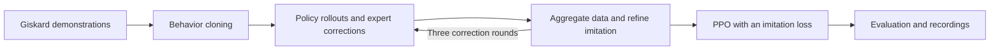

# GARMI Mobile Grasp RL

Mobile grasping in the GARMI kitchen with **Giskard expert demonstrations, imitation learning, and PPO**. The policy coordinates the mobile base and right arm to approach an object, followed by a fixed controller that closes the gripper, lifts the object, and holds it.

This repository brings together bowl and YCB mug/pitcher training, cup and milk-carton expert workflows, and a CRAM + RL mobile manipulation demo.

## Demo

In the full GARMI apartment scene, the robot picks up a bowl from the kitchen counter and places it on the dining table. CRAM handles navigation and transport, RL controls the base and right arm during the grasp approach, and a fixed controller performs closing and lifting.

[Grasp close-up](https://zhiyuan-gao.github.io/franka-tabletop-tasks/demos/videos/garmi_rl_grasp.mp4) · [Episodes with varied starting positions](https://zhiyuan-gao.github.io/franka-tabletop-tasks/demos/garmi/episodes/) · [Demo gallery and workspace](https://zhiyuan-gao.github.io/franka-tabletop-tasks/demos/garmi/)

The interactive workspace provides live views, task progress, and recordings. See the [deployment quickstart](binder/README.md) to run the demo.

## Grasping task

The robot starts near the kitchen counter and uses the object state and a reference grasp pose to coordinate its base and arm movements. Training varies object placement and robot starting positions. Position-dependent reference filtering accounts for nearby furniture.

- **Observations:** 64-dimensional state including robot joints, base state, relative object pose, reference grasp pose, and finger contacts.
- **Actions:** three base velocity commands and seven right-arm joint increments.
- **Objective:** grasp, lift, and hold the object.
- **Grasp references:** 40 fixed references for the bowl, plus separately validated sets of 40 references each for the YCB mug and pitcher.

Reference visualizations, placement regions, and validation records are available in [YCB v6 grasp references](resources/validated-ycb-v6/README.md).

## Training workflow



1. **Collect demonstrations:** execute Giskard grasp approaches, including demonstrations with motion perturbations.
2. **Train behavior cloning:** learn the expert's base and arm actions.
3. **Collect expert corrections:** query Giskard at states visited by the policy, aggregate the data, and refine the policy.
4. **Train with PPO:** improve through simulation while retaining an expert imitation loss.
5. **Evaluate:** compare checkpoints on fixed cases and record episodes.

The training setup uses three correction rounds, 4096 parallel PPO environments, and 8000 PPO updates, with evaluation every 500 updates.

## Published mug checkpoint

The **update-6500 checkpoint** achieves **77.5% success (62/80)** on fixed evaluation cases covering 40 known grasp references. Success measures physically lifting and holding the mug.

[Download the checkpoint and runtime bundle](https://github.com/zhiyuan-gao/garmi-mobile-grasp-rl/releases/tag/mug-ppo-6500-20261022) · [Evaluation and resume instructions](docs/mug-ppo-6500.md) · [Training configuration](configs/mug-ppo6500.yaml) · [Evaluation records](resources/mug-ppo6500/evaluation.json)

The release includes the model, paired resume state, training source snapshot, configuration, fixed starting states, and evaluation records. The usage guide covers asset and expert-data import, evaluation, and continued training.

## Getting started

The runtime uses **Isaac Sim 5.1.0, Isaac Lab 2.3.2, PyTorch 2.7.0, and skrl 1.4.3**.

```bash
git clone --branch main \
  https://github.com/zhiyuan-gao/garmi-mobile-grasp-rl.git
cd garmi-mobile-grasp-rl
```

| Goal | Guide |
| --- | --- |
| Set up the environment and run training | [Installation and usage](docs/usage.md) |
| Evaluate or resume the published mug model | [Mug checkpoint guide](docs/mug-ppo-6500.md) |
| Run the CRAM + RL demo | [Deployment quickstart](binder/README.md) |
| Record a mug grasp followed by dual-arm drawer manipulation | [Mug-to-drawer demo](demos/mug_drawer/README.md) |
| Explore observations, actions, rewards, and randomization | [Experiment settings](docs/experiment.md) |

The demo packages its trained bowl policy, 40 grasp references, and position filter, with asset preparation handled during container setup.

## Code overview

| File | Purpose |
| --- | --- |
| [configs/task.yaml](configs/task.yaml) | Bowl task and training configuration |
| [configs/mug-ppo6500.yaml](configs/mug-ppo6500.yaml) | Published mug experiment configuration |
| [rl/run_40ref_experiment.py](rl/run_40ref_experiment.py) | End-to-end bowl training workflow |
| [rl/collect_giskard.py](rl/collect_giskard.py) | Expert and perturbed demonstration collection |
| [rl/garmi_rl/giskard_expert.py](rl/garmi_rl/giskard_expert.py) | Giskard expert for coordinated base and arm control |
| [rl/train_expert_bc.py](rl/train_expert_bc.py) | Behavior cloning |
| [rl/garmi_rl/expert_ppo.py](rl/garmi_rl/expert_ppo.py) | PPO with an expert imitation loss |
| [rl/evaluate_kitchen.py](rl/evaluate_kitchen.py) | Policy evaluation and recordings |
| [scripts/prepare_cup.py](scripts/prepare_cup.py) | Cup experiment preparation |
| [scripts/prepare_milk.py](scripts/prepare_milk.py) | Milk-carton experiment preparation |

## Mug-to-drawer demonstration

The [standalone drawer demo](demos/mug_drawer/README.md) uses the published mug
PPO 6500 policy for a right-hand body grasp, followed by Cartesian IK for
left-hand drawer opening, right-hand placement and left-hand closing. It runs
in the complete GARMI apartment, exports a standalone 4× MP4, and includes an
optional renderer for all 40 mug and bowl reference grasps. Models and scene
assets are reused from the existing releases and runtime.

## VRB presentation materials

[Lab introduction preview](https://zhiyuan-gao.github.io/franka-tabletop-tasks/demos/garmi/vrb-overview.html) · [Presentation package](https://zhiyuan-gao.github.io/franka-tabletop-tasks/demos/garmi/vrb-intro-package.zip)

The package includes grasping and full-task videos, project descriptions, repository links, an embeddable introduction section, and instructions for connecting the Enter Lab button to the interactive workspace.

## Repositories

This repository's `main` branch maintains training, evaluation and task code,
including the bowl counter-to-table and mug-to-drawer demonstrations.
The [CRAM Lab fork](https://github.com/zhiyuan-gao/cram-vrb-lab/tree/garmi-rl-native-demo)
provides the Binder image and desktop workspace. It installs a versioned runtime
built from the [Isaac Sim 6.1 deployment sources](deployment/isaac61/README.md).
See [repository roles and the update workflow](docs/repositories.md).
