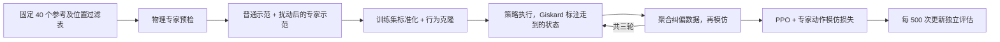

# GARMI mobile grasp RL

在 Isaac Sim 5.1.0 的 GARMI 厨房环境中，用 **Giskard 专家示范 → 行为克隆 → 三轮专家纠偏 → 带模仿损失的 PPO** 学习移动抓取。

本仓库整理当前的**碗、40 个固定参考抓取、厨房大范围随机初始位置**实验。策略同时控制底盘和右臂；接近完成后，由固定程序闭爪、提起和保持。这里没有导航、搬运、放置或 CRAM 任务交接，也不是 GA-DDPG 原论文的完整复现。

这是正在进行的实验的代码导出，**8000 次 PPO 的最终结果尚未产生**。旧实验、数据集、模型权重、仿真二进制资产和录像没有提交到 Git。

## 流程



| 环节 | 当前设置 |
| --- | --- |
| 普通专家示范 | 每个参考 250 条成功轨迹，验证 20 条 |
| 扰动专家示范 | 每个参考 50 条成功轨迹，验证 5 条；扰动动作不作为标签 |
| 初始行为克隆 | 100 epochs，按参考均衡采样，动作 MSE |
| 专家纠偏 | 3 轮；每轮 2000 条策略轨迹，另有 400 条验证轨迹 |
| 纠偏监督 | 策略自己执行；专家只标注实际访问状态，失败查询不补零 |
| PPO | 4096 环境、24 步 rollout、8000 次新增更新，BC 系数 3 |
| 评估 | 固定 4000 个场景，每参考 100 个；与采集/纠偏数据分离 |

评估集包含全部 40 个训练参考，用于比较模型版本，**不是未见抓法测试，也不是独立最终泛化测试集**。每 500 次保存和评估，额外的 8 次容量短测计入 8000 更新。

## 运行条件

- Linux、Docker、NVIDIA Container Toolkit、兼容 Isaac Sim 5.1.0 的 NVIDIA 驱动。
- 固定基础镜像内含 Isaac Sim 5.1.0 和 CRAM/Giskard Python 环境；镜像摘要见 [Dockerfile](rl/Dockerfile)。使用前需自行接受 NVIDIA 的相关许可。
- Isaac Lab v2.3.2，固定提交 `37ddf626871758333d6ed89cf64ad702aef127d0`。
- Isaac Python 3.11、PyTorch 2.7.0、skrl 1.4.3；完整 Python 约束见 [runtime-constraints.txt](rl/runtime-constraints.txt)。宿主监督脚本需要 Python 3 和 PyYAML。
- 原工作站的 PPO 设置是 RTX 4070 12 GB、约 64 GB 系统内存。4096 环境只代表此任务的已用配置，不是所有显卡的保证。

### 1. 准备代码与运行环境

```bash
git clone https://github.com/zhiyuan-gao/garmi-mobile-grasp-rl.git
cd garmi-mobile-grasp-rl
python3 -m venv .venv
. .venv/bin/activate
pip install -r requirements-host.txt
bash scripts/setup.sh
```

默认创建独立容器 `garmi-mobile-grasp-rl`，把本仓库挂载到 `/workspace`。可用环境变量 `GARMI_RL_CONTAINER` 改名。脚本会检查已有同名容器的挂载目录，避免误用另一个项目。

### 2. 准备经过验证的资产

**仅克隆代码不能直接训练。** 此版本依赖已经导出的机器人 USD、厨房碰撞几何、碗、40 个参考和位置过滤表；不附带从原始场景重建全部导出资产的工具。

在已有 FAME_RL 工作区的机器上运行：

```bash
python3 scripts/import_assets.py --from-workspace /path/to/FAME_RL
```

导入工具只取 [asset-sources.json](resources/asset-sources.json) 列出的文件，先验证原始 SHA256，再调整路径；40 个参考的数值、几何和过滤表的格子不变。迁移后的 bank/mask 哈希重新计算，原始哈希保留为溯源信息。数字参考也可直接查看 [bowl-40-references.json](resources/bowl-40-references.json)。

资产导入完成后，可以把生成的 `assets/` 和 `rl/assets/` 目录单独迁移到另一台机器的同名位置。它们被 Git 忽略，使用和分发仍遵循各资产的上游许可。资产来源为 `yxzhan/cram-vrb-lab` 的 GARMI 工作区，基准提交 `41c103214a0c89899e4c5ee28428b2f31b116307`；训练导出资产还包含本地运动/碰撞适配，因此直接下载原仓库不能替代此哈希匹配的资产包。

### 3. 选择初始化方式

**重新采集全部 40 个参考，从新网络开始：**

```bash
python3 rl/prepare_40ref_trial.py --out runs/bowl40
```

这保留同样的数据使用方法和任务设置，但不是当前实验的相同模型初始化；此新增入口尚未完整跑完训练。

**复用当前实验使用的四参考模型和专家数据：**

```bash
python3 scripts/import_bootstrap.py --from-workspace /path/to/FAME_RL
python3 rl/prepare_40ref_trial.py --out runs/bowl40 --bootstrap
```

只导入所需的初始化模型、1200 条训练示范、100 条验证示范、已有纠偏标签和 1200 个回归评估场景。它们放在 `bootstrap/`，不会上传。此模式补采其余 36 个参考，合并后也是每参考 300 条训练示范。完整运行不需要复制历史实验目录。

`prepare` 冻结配置与评估场景，不启动模拟器。输出目录必须不存在。

### 4. 检查并启动

```bash
python3 rl/run_40ref_experiment.py --out runs/bowl40 --check-only
python3 -u rl/run_40ref_experiment.py --out runs/bowl40
```

`--check-only` 是文件/配置检查；**不是物理可行性检查**。正式启动后，监督脚本先做 128 环境边界重置检查、400 个专家物理预检场景、少量扰动采集、数据审计、2 个 BC epochs 和 2 次 PPO 接口检查，成功后自动继续。任何参考在专家预检中没有成功案例会停止，具体失败保留在报告中。

GPU 阶段串行执行；专家采集使用 128 个仿真环境和 8 个 CPU Giskard 工作进程。PPO 训练进程退出后再独立评估，以释放显存。可通过 `runs/bowl40/supervisor.json` 和 `REPORT.md` 看进度；每个 PPO 阶段另有 `steps.csv`、`updates.csv` 和检查点。

`--resume` 只用于已标记 failed/interrupted 的队列；完成阶段复用，普通/扰动正式示范保留已经验证的样本，并换新种子继续。其他未完成阶段会归档后重做，未完成的单个 PPO 阶段不是逐步无损恢复。不要同时启动两份同一输出目录的监督脚本。

### 5. 评估和录像

```bash
bash scripts/rl.sh /workspace/rl/evaluate_kitchen.py \
  --headless --config /workspace/runs/bowl40/task.yaml \
  --checkpoint /workspace/runs/bowl40/ppo-0500/checkpoints/update_0500.pt \
  --num_envs 240 --out /workspace/runs/eval-500

bash scripts/rl.sh /workspace/rl/evaluate_kitchen.py \
  --headless --enable_cameras --num_envs 1 --case-index 0 \
  --config /workspace/runs/bowl40/task.yaml \
  --checkpoint /workspace/runs/bowl40/ppo-0500/checkpoints/update_0500.pt \
  --out /workspace/runs/video-case-0
```

录像放在单独阶段，避免占用正式训练的显存。检查点路径应以实际 `progress.json` 为准。

## 代码入口

| 文件 | 内容 |
| --- | --- |
| [configs/task.yaml](configs/task.yaml) | 当前任务、奖励、网络、PPO 参数模板 |
| [rl/run_40ref_experiment.py](rl/run_40ref_experiment.py) | 完整流程监督及阶段记录 |
| [rl/collect_giskard.py](rl/collect_giskard.py) | 物理专家示范、扰动示范及续采 |
| [rl/garmi_rl/giskard_expert.py](rl/garmi_rl/giskard_expert.py) | 仅接近抓取部分的全身 Giskard 专家 |
| [rl/build_giskard_labels.py](rl/build_giskard_labels.py) | 策略访问状态上的专家标签 |
| [rl/train_expert_bc.py](rl/train_expert_bc.py) | 行为克隆 |
| [rl/garmi_rl/expert_ppo.py](rl/garmi_rl/expert_ppo.py) | PPO 加独立专家 minibatch 的 BC 损失 |
| [rl/garmi_rl/fixed_finish.py](rl/garmi_rl/fixed_finish.py) | 固定闭爪、提起、保持 |
| [rl/garmi_rl/kitchen.py](rl/garmi_rl/kitchen.py) | 厨房随机化及位置过滤 |

细节见 [实验设置](docs/experiment.md)、[导出验证与限制](docs/validation.md)、[第三方说明](THIRD_PARTY_NOTICES.md)。
