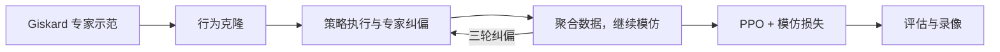

# GARMI mobile grasp RL

在 Isaac Sim 的 GARMI 厨房环境中，结合 **Giskard 专家示范、模仿学习和 PPO**，训练机器人同时控制底盘与机械臂完成抓取。

## 任务

机器人从厨房柜台前的随机位置出发，根据物体位置和参考抓取姿态，一边调整底盘，一边移动右臂接近物体。接近完成后，固定程序负责闭爪、提起和保持。

当前任务使用碗和 **40 个固定参考抓取**。每个回合随机摆放碗、随机初始化机器人位置，并根据家具遮挡情况选择可用的抓取参考。

- **策略输入**：机器人关节与底盘状态、物体相对位置、参考抓取位姿、手指接触等 64 维状态。
- **策略动作**：底盘的 3 个速度，以及右臂的 7 个关节增量。
- **任务目标**：抓起碗并稳定保持。

## 训练流程

1. **采集示范**：用 Giskard 完成接近抓取，收集普通示范和加入运动扰动后的示范。
2. **行为克隆**：让策略学习专家的底盘和手臂动作。
3. **专家纠偏**：让策略自己执行，再用 Giskard 标注策略实际访问的状态，聚合数据继续学习。
4. **PPO 训练**：通过仿真交互提高抓取能力，同时保留专家动作的模仿损失。
5. **评估与录像**：在固定场景中比较不同检查点，记录成功率和执行视频。

默认配置使用三轮纠偏、4096 个并行 PPO 环境和 8000 次 PPO 更新，每 500 次更新评估一次。

## 使用

运行环境为 **Isaac Sim 5.1.0、Isaac Lab 2.3.2、PyTorch 2.7.0 和 skrl 1.4.3**。

[安装与运行](docs/usage.md)包含环境搭建、仿真资产导入、训练启动、评估和录像命令。[实验设置](docs/experiment.md)说明状态、动作、奖励、随机化范围和训练参数。

## 主要代码

| 文件 | 用途 |
| --- | --- |
| [configs/task.yaml](configs/task.yaml) | 任务与训练配置 |
| [rl/run_40ref_experiment.py](rl/run_40ref_experiment.py) | 完整训练流程 |
| [rl/collect_giskard.py](rl/collect_giskard.py) | 专家示范与扰动示范采集 |
| [rl/garmi_rl/giskard_expert.py](rl/garmi_rl/giskard_expert.py) | 控制底盘与右臂的 Giskard 专家 |
| [rl/train_expert_bc.py](rl/train_expert_bc.py) | 行为克隆 |
| [rl/garmi_rl/expert_ppo.py](rl/garmi_rl/expert_ppo.py) | 带模仿损失的 PPO |
| [rl/evaluate_kitchen.py](rl/evaluate_kitchen.py) | 策略评估与录像 |
