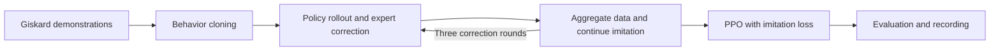

# GARMI mobile grasp RL

Train coordinated base and arm grasping in the Isaac Sim GARMI kitchen using **Giskard expert demonstrations, imitation learning and PPO**.

## Interactive demo

This branch includes the full **counter-to-table bowl task**: CRAM navigation, RL control of the base and right-arm approach, a fixed close-and-lift routine, and CRAM transport and placement. The web interface shows the live camera and task progress and saves a recording for each run.

[Demo page](https://zhiyuan-gao.github.io/franka-tabletop-tasks/demos/garmi/) · [Recordings with different initial poses](https://zhiyuan-gao.github.io/franka-tabletop-tasks/demos/garmi/episodes/) · [Deployment quick start](binder/README.md)

The policy, 40 grasp references and position filter are packaged for the demo. The quick start covers cloning, local Docker or VRB deployment, execution and saving results.

The local **GARMI RL Counter to Table** desktop launcher runs 10 episodes, recreating the simulator and planner for each episode. The existing bowl starts at the fixed left-counter map position `(0.2, 7.4)`. See the [Workspace instructions](integration/web/README.md). Training randomization described below is separate from this fixed desktop demo.

## Training task

The robot starts at a random position in front of the kitchen counter. Using the object position and a grasp reference, it moves the base and right arm toward the bowl. A fixed routine then closes the gripper, lifts and holds.

The task uses a bowl and **40 fixed grasp references**. Each training episode randomizes the bowl and robot positions and chooses a reference allowed by the furniture occlusion filter.

- **Policy input:** 64 state values including joints, base state, relative object position, reference grasp pose and finger contacts.
- **Policy action:** three base velocities and seven right-arm joint increments.
- **Objective:** lift the bowl and hold it stably.

## Training workflow

1. **Collect demonstrations:** use Giskard to approach grasps, collecting ordinary and motion-perturbed demonstrations.
2. **Behavior cloning:** learn the expert's base and arm actions.
3. **Expert correction:** label states visited by the policy with Giskard actions, aggregate them and continue learning.
4. **PPO training:** improve grasping through simulation while retaining expert-action imitation loss.
5. **Evaluation and recording:** compare checkpoints on fixed cases and record success rates and videos.

The default configuration uses three correction rounds, 4096 parallel PPO environments and 8000 PPO updates, with evaluation every 500 updates.

## Usage

The baseline training environment uses **Isaac Sim 5.1.0, Isaac Lab 2.3.2, PyTorch 2.7.0 and skrl 1.4.3**. The local desktop demo uses the Isaac Sim 6.1 compatibility environment documented in [LOCAL_INSTALL.txt](LOCAL_INSTALL.txt).

[Installation and usage](docs/usage.md) covers environment setup, simulation asset import, training, evaluation and recording. [Experiment settings](docs/experiment.md) documents observations, actions, rewards, randomization and training parameters.

## Main code

| File | Purpose |
| --- | --- |
| [configs/task.yaml](configs/task.yaml) | Task and training configuration |
| [rl/run_40ref_experiment.py](rl/run_40ref_experiment.py) | Complete training workflow |
| [rl/collect_giskard.py](rl/collect_giskard.py) | Ordinary and perturbed expert demonstrations |
| [rl/garmi_rl/giskard_expert.py](rl/garmi_rl/giskard_expert.py) | Giskard expert for the base and right arm |
| [rl/train_expert_bc.py](rl/train_expert_bc.py) | Behavior cloning |
| [rl/garmi_rl/expert_ppo.py](rl/garmi_rl/expert_ppo.py) | PPO with imitation loss |
| [rl/evaluate_kitchen.py](rl/evaluate_kitchen.py) | Policy evaluation and recording |
